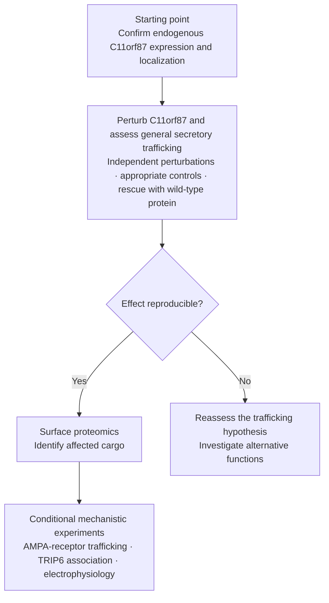

# C11orf87 / TMEM151A Proposal — Experimental Design and Submission Requirements

**Scope.** The proposal is to discover and experimentally characterize understudied
neuronal membrane proteins across neurological and psychiatric disorders.
C11orf87 is the initial exploratory case; TMEM151A provides an established
disease-genetics case with unresolved molecular questions. The AMPA-receptor
trafficking idea is presented as a **hypothesis to test, not a discovery already made**.

---

## 3. The experimental decision that matters

### Proposed first experiment

A **decision-based design**, rather than experiments chosen to confirm our preferred
hypothesis. Each stage determines whether the next is justified.

| Stage | Experiment | Requirement / outcome |
|---|---|---|
| 1. Starting point | Confirm endogenous C11orf87 expression and localization | Must be established before any perturbation is interpreted |
| 2. Perturbation | Perturb C11orf87 and assess **general** secretory trafficking | Independent perturbations, appropriate controls, rescue with wild-type protein |
| 3a. Reproducible effect | Surface proteomics | Identify which cargo is affected |
| 3b. Effect not reproduced | Reassess the trafficking hypothesis | Investigate alternative functions |
| 4. Conditional mechanism | AMPA-receptor trafficking, TRIP6 association, electrophysiological consequences | Performed **only** when supported by the preceding results |

**Why this order.** Assessing general secretory trafficking first, with rescue,
avoids confusing a general reduction in cellular health or protein secretion with
selective AMPA-receptor regulation.

---

## 4. What I would require before submission

A proposal can be ready for a collaboration discussion without claiming an original
discovery. A publication-level novelty claim requires more:

- [ ] Search PubMed, Europe PMC, bioRxiv, medRxiv, Google Scholar, patents and relevant
      supplementary datasets using **every gene alias** and the specific proposed mechanisms.
- [ ] Retrieve the original interaction-screen and trafficking-screen records, including
      their controls and validation status.
- [ ] Reanalyse complete expression datasets with matched control genes and correction
      for multiple testing.
- [ ] Maintain a dated evidence register distinguishing primary experimental findings,
      database annotations, computational predictions and our own hypotheses.
- [ ] Ask the collaborating laboratory to assess experimental feasibility and
      independently review the novelty claim before committing resources.

### Evidence register template

| Date | Claim | Evidence class | Source / record ID | Validation status | Notes |
|---|---|---|---|---|---|
| YYYY-MM-DD | | Primary experimental · Database annotation · Computational prediction · Our hypothesis | | | |

---

## Final assessment — proposal readiness

| Dimension | Status |
|---|---|
| Scientific rationale | Established |
| Specific research questions | Defined |
| Prior-art review | Substantial, incomplete |
| Independent computational results | Still required |
| Novel mechanism demonstrated | Not yet |
| Suitable for an exploratory laboratory discussion | **Yes** |

## Summary

The proposal is to discover and experimentally characterize understudied neuronal
membrane proteins across neurological and psychiatric disorders. C11orf87 is our
initial exploratory case, while TMEM151A provides an established disease-genetics
case with unresolved molecular questions. We should present our AMPA-trafficking
idea as a hypothesis to test, not a discovery already made.
